# Workflow Lengkap Sistem BILIK (Diagram Interaktif)

**Status:** P1 - Acuan Visual Tim Backend & Frontend  
**Terakhir diperbarui:** 25 November 2026  
**Model Peran:** Warga & Admin (+ Admin Master)

---

## Diagram Arsitektur & Alur Kerja Menyeluruh

```mermaid
flowchart TB
    %% ============================================================
    %% STYLING
    %% ============================================================
    classDef warga fill:#e3f2fd,stroke:#1565c0,stroke-width:2px,color:#0d47a1
    classDef wargaAksi fill:#bbdefb,stroke:#1565c0,stroke-width:2px,color:#0d47a1
    classDef admin fill:#fff3e0,stroke:#ef6c00,stroke-width:2px,color:#e65100
    classDef adminAksi fill:#ffe0b2,stroke:#ef6c00,stroke-width:2px,color:#e65100
    classDef sistem fill:#f3e5f5,stroke:#6a1b9a,stroke-width:2px,color:#4a148c
    classDef cron fill:#ede7f6,stroke:#6a1b9a,stroke-width:1px,color:#4a148c
    classDef db fill:#e8f5e9,stroke:#2e7d32,stroke-width:2px,color:#1b5e20
    classDef notif fill:#fce4ec,stroke:#c62828,stroke-width:2px,color:#b71c1c
    classDef keputusan fill:#fff9c4,stroke:#f9a825,stroke-width:2px,color:#e65100

    %% ============================================================
    %% ZONA 1: WARGA (UI E-COMMERCE)
    %% ============================================================
    subgraph Z_WARGA ["ZONA WARGA - Antarmuka Utama Gaya E-Commerce"]
        direction TB

        subgraph W_NAV ["Navigasi Utama"]
            W_Home(["Homepage BILIK<br/>Banner, Kategori, Buku Terkini, Pencarian"]):::warga
            W_Katalog["Halaman Katalog<br/>Filter Kategori, Cari Judul/Penulis/ISBN"]:::warga
            W_Detail["Halaman Detail Buku<br/>Stok Eksemplar, Sinopsis, Cover 2:3"]:::warga
            W_Home --> W_Katalog --> W_Detail
        end

        subgraph W_PROFIL ["Menu Profil Warga (Dropdown Header)"]
            W_ProfilPage["Profil & Kartu Anggota Digital<br/>Data Diri, NIS/NIP, QR Code"]:::warga
            W_PinjamanSaya["Pinjaman Saya<br/>Status Aktif/Terlambat, Countdown Jatuh Tempo"]:::warga
            W_AntreanSaya["Antrean & Pengajuan Saya<br/>Status Pengajuan, Posisi Antrean FIFO"]:::warga
            W_FavoritSaya["Favorit Saya<br/>Daftar Buku Tersimpan"]:::warga
            W_NotifSaya["Notifikasi Saya<br/>Riwayat In-App & Preferensi Email"]:::warga
        end

        subgraph W_AKSI ["Aksi Warga di Detail Buku & Profil"]
            W_AksiPilih{Pilih Aksi<br/>di Detail Buku}:::keputusan
            W_Ajuan["Ajukan Peminjaman Online<br/>Kunci 1 Eksemplar Fisik BK-xxxx<br/>Countdown 24 Jam Dimulai"]:::wargaAksi
            W_Antre["Masuk Antrean FIFO<br/>Jika Stok Tersedia = 0<br/>Maks 3 atau 5 Orang"]:::wargaAksi
            W_Favorit["Simpan / Hapus Favorit<br/>Toggle Ikon Hati di Detail Buku"]:::wargaAksi
            W_Ulasan["Beri Rating 1-5 & Tulis Ulasan<br/>Khusus Buku yang Pernah Dipinjam"]:::wargaAksi
            W_BatalPengajuan["Batalkan Pengajuan / Antrean<br/>Sebelum Diproses Admin"]:::wargaAksi
            W_Perpanjang["Ajukan Perpanjangan Pinjaman<br/>Isi Alasan Wajib & Jumlah Hari<br/>Boleh Meski Ada Antrean"]:::wargaAksi
        end

        W_Detail --> W_AksiPilih
        W_AksiPilih -- "Stok Tersedia > 0" --> W_Ajuan
        W_AksiPilih -- "Stok Tersedia = 0" --> W_Antre
        W_AksiPilih -- "Simpan Buku" --> W_Favorit
        W_AksiPilih -- "Sudah Pernah Pinjam" --> W_Ulasan
        W_AntreanSaya --> W_BatalPengajuan
        W_PinjamanSaya --> W_Perpanjang

        W_Home --> W_ProfilPage
    end

    %% ============================================================
    %% ZONA 2: MESIN BACKEND & DATABASE
    %% ============================================================
    subgraph Z_BACKEND ["MESIN BACKEND & DATABASE - Jembatan Penghubung"]
        direction TB

        subgraph BE_VALIDASI ["Gerbang Validasi Kelayakan"]
            DB_Val{"Validasi Kelayakan Warga:<br/>1. Tidak Terblokir<br/>2. Denda belum_lunas = 0<br/>3. Single-Item Rule < 1"}:::keputusan
            DB_ValOK["Lolos Validasi"]:::sistem
            DB_ValGagal["Ditolak dengan Kode Error<br/>AKUN_TERBLOKIR / DENDA_BELUM_LUNAS<br/>/ KUOTA_PINJAM_PENUH"]:::sistem
            DB_Val -- "Lolos" --> DB_ValOK
            DB_Val -- "Gagal" --> DB_ValGagal
        end

        subgraph BE_DATA ["Tabel Database Utama"]
            DB_Res[("Tabel: reservasi<br/>+ eksemplar<br/>Status: siap_diambil /<br/>menunggu / batal /<br/>ditolak / kedaluwarsa")]:::db
            DB_Pinjam[("Tabel: pinjaman<br/>+ denda<br/>Status: aktif / terlambat /<br/>selesai<br/>Denda: belum_lunas /<br/>lunas / dibebaskan")]:::db
            DB_Perpanjangan[("Tabel: ajuan_perpanjangan<br/>Status: menunggu /<br/>disetujui / ditolak")]:::db
            DB_Favorit[("Tabel: favorit<br/>pengguna_id + buku_id")]:::db
            DB_Ulasan[("Tabel: ulasan<br/>Rating 1-5 + Teks Ulasan")]:::db
            DB_Audit[("Tabel: log_audit<br/>IMMUTABLE<br/>kode_commit, pesan_commit,<br/>data_lama, data_baru")]:::db
        end

        subgraph BE_ENGINE ["Sub-rutin & Mesin Atomik"]
            DB_FIFO[["Sub-rutin Promosi Antrean FIFO<br/>SELECT ... FOR UPDATE SKIP LOCKED<br/>Alokasikan Stok ke Antrean #1"]]:::sistem
            DB_Notif[["Mesin Notifikasi<br/>In-App + Email Idempoten<br/>via Tabel antrean_email"]]:::notif
        end

        DB_ValOK --> DB_Res
    end

    %% ============================================================
    %% ZONA 3: ADMIN & ADMIN MASTER (BACKOFFICE)
    %% ============================================================
    subgraph Z_ADMIN ["ZONA ADMIN & ADMIN MASTER - Dashboard Backoffice"]
        direction TB

        A_Switch(["Admin Login di Homepage<br/>Klik 'Beralih ke Mode Admin'<br/>di Dropdown Profil"]):::admin
        A_Dash["Dashboard Admin<br/>Total Katalog, Eksemplar,<br/>Pinjaman Aktif, Jumlah Anggota"]:::admin
        A_Switch --> A_Dash

        subgraph A_MODUL ["Modul Sidebar Admin"]
            M_Sirkulasi["Meja Sirkulasi<br/>- Klaim Pengajuan Online<br/>  Scan Kartu + Barcode BK-xxxx<br/>- Pinjam Langsung Offline<br/>  Scan Kartu + Barcode Tersedia<br/>- Pengembalian Buku Fisik<br/>  Pilih Kondisi: Baik/Rusak/Hilang<br/>- Hitung Denda Rp500/hari Otomatis"]:::adminAksi
            M_Perpanjangan["Konfirmasi Perpanjangan<br/>- Lihat Alasan Warga<br/>- Setujui / Ubah Hari via Stepper<br/>- Tolak dengan Alasan + Commit"]:::adminAksi
            M_Katalog["Koleksi & Eksemplar<br/>- CRUD Master Buku & Kategori<br/>- CRUD Eksemplar Fisik<br/>- Cetak Label Barcode BK-xxxx"]:::adminAksi
            M_Opname["Stock Opname Fast-Scan<br/>- Buat Sesi Baru<br/>- Pindai Barcode Beruntun<br/>- Tinjau Selisih / Diff<br/>- Commit Opname + Pesan"]:::adminAksi
            M_Denda["Denda & Pelunasan<br/>- Konfirmasi Lunas Tunai<br/>- Koreksi Nominal Tunggal/Batch<br/>- Pembebasan Denda + Commit"]:::adminAksi
            M_Anggota["Keanggotaan & Blokir<br/>- CRUD Akun Warga<br/>- Buka Blokir Permanen<br/>- Soft Delete Lulus/Pindah<br/>- Hard Delete Salah Buat"]:::adminAksi
            M_Kebijakan["Pengaturan Kebijakan Sistem<br/>- Tarif Denda per Hari<br/>- Durasi Pinjam Default<br/>- Kuota Maks Buku Aktif<br/>- Batas Pengambilan 24 Jam<br/>- Kapasitas Antrean FIFO"]:::adminAksi
            M_AuditLog["Audit Log & Commit History<br/>- Kronologi Seluruh Transaksi<br/>- Filter Aktor, Aksi, Tanggal<br/>- Read-Only / Immutable"]:::adminAksi
            M_Master["KHUSUS Admin Master<br/>- Tambah / Cabut Akun Admin<br/>- Proteksi Kekebalan Master"]:::adminAksi
        end

        A_Dash --> M_Sirkulasi
        A_Dash --> M_Perpanjangan
        A_Dash --> M_Katalog
        A_Dash --> M_Opname
        A_Dash --> M_Denda
        A_Dash --> M_Anggota
        A_Dash --> M_Kebijakan
        A_Dash --> M_AuditLog
        A_Dash --> M_Master
    end

    %% ============================================================
    %% ZONA 4: SISTEM OTOMATIS (CRON JOBS)
    %% ============================================================
    subgraph Z_CRON ["SISTEM OTOMATIS - Cron Jobs Terjadwal"]
        direction LR
        C_Expire["Cron Kedaluwarsa 24 Jam<br/>Tiap 5 Menit<br/>siap_diambil yang lewat waktu<br/>-> kedaluwarsa + Poin No-Show<br/>-> 3x No-Show = Blokir 7 Hari<br/>-> 3x Blokir = Blokir Permanen"]:::cron
        C_Telat["Cron Keterlambatan Harian<br/>Tiap Hari 00:05 WIB<br/>aktif yang lewat jatuh tempo<br/>-> terlambat + Notifikasi"]:::cron
        C_Reminder["Cron Pengingat Berkala<br/>Tiap 1 Jam<br/>- 6 Jam sebelum Tenggat 24 Jam<br/>- H-1 sebelum Jatuh Tempo"]:::cron
    end

    %% ============================================================
    %% RELASI LINTAS ZONA: Warga -> Backend
    %% ============================================================
    W_Ajuan --> DB_Val
    W_Antre --> DB_Val
    W_Perpanjang --> DB_Perpanjangan
    W_Favorit --> DB_Favorit
    W_Ulasan --> DB_Ulasan
    W_BatalPengajuan --> DB_Res

    %% ============================================================
    %% RELASI LINTAS ZONA: Backend -> Admin (Notifikasi)
    %% ============================================================
    DB_Res -. "Notif: Pengajuan Baru Masuk" .-> M_Sirkulasi
    DB_Perpanjangan -. "Notif: Ajuan Perpanjangan Baru" .-> M_Perpanjangan
    DB_Pinjam -. "Notif: Pinjaman Terlambat" .-> M_Sirkulasi

    %% ============================================================
    %% RELASI LINTAS ZONA: Interaksi Fisik Warga <-> Meja Admin
    %% ============================================================
    W_Ajuan == "Warga Datang ke Perpustakaan<br/>Tunjukkan Kartu Anggota + Buku Fisik" ==> M_Sirkulasi
    M_Sirkulasi == "Admin Scan Kartu & Barcode<br/>Ubah Status: direservasi -> dipinjam" ==> DB_Pinjam
    W_PinjamanSaya == "Warga Kembalikan Buku Fisik" ==> M_Sirkulasi
    M_Sirkulasi == "Admin Proses Kembali<br/>Cek Denda + Trigger FIFO jika Baik" ==> DB_FIFO

    %% ============================================================
    %% RELASI LINTAS ZONA: Perpanjangan Admin -> Backend
    %% ============================================================
    M_Perpanjangan -- "Setujui / Tolak" --> DB_Perpanjangan
    DB_Perpanjangan -- "Jika Disetujui:<br/>Tambah tanggal_jatuh_tempo" --> DB_Pinjam

    %% ============================================================
    %% RELASI LINTAS ZONA: FIFO -> Reservasi -> Notifikasi
    %% ============================================================
    DB_FIFO -- "Promosikan Antrean #1<br/>ke siap_diambil + 24 Jam" --> DB_Res
    DB_FIFO -- "Jika Tidak Ada Antrean<br/>-> eksemplar = tersedia" --> DB_Res

    %% ============================================================
    %% RELASI LINTAS ZONA: Semua Mutasi Admin -> Audit Log
    %% ============================================================
    M_Sirkulasi & M_Perpanjangan & M_Katalog & M_Opname & M_Denda & M_Anggota & M_Kebijakan & M_Master -- "Wajib pesan_commit" --> DB_Audit

    %% ============================================================
    %% RELASI LINTAS ZONA: Cron Jobs -> Database & Notifikasi
    %% ============================================================
    C_Expire --> DB_Res
    C_Expire --> DB_FIFO
    C_Telat --> DB_Pinjam
    C_Expire & C_Telat & C_Reminder --> DB_Notif

    %% ============================================================
    %% RELASI LINTAS ZONA: Notifikasi -> Warga
    %% ============================================================
    DB_Notif -. "In-App + Email ke Warga<br/>Pengingat, Promosi Antrean,<br/>Kedaluwarsa, Perpanjangan" .-> W_NotifSaya
    DB_Notif -. "In-App ke Admin<br/>Pengajuan Baru, Perpanjangan" .-> A_Dash
```

---

## Legenda Warna & Simbol

| Warna | Zona | Keterangan |
|---|---|---|
| Biru (`#e3f2fd`) | **Warga** | Seluruh halaman dan aksi yang diakses oleh pemustaka (siswa, guru, staf, termasuk Admin saat Mode Warga). |
| Oranye (`#fff3e0`) | **Admin & Admin Master** | Dashboard backoffice, modul sidebar, dan seluruh aksi operasional/manajerial perpustakaan. |
| Ungu (`#f3e5f5`) | **Sistem & Mesin Backend** | Sub-rutin atomik, validasi kelayakan, dan Cron Jobs otomatis yang berjalan tanpa intervensi manusia. |
| Hijau (`#e8f5e9`) | **Database (Tabel)** | Representasi tabel PostgreSQL utama beserta status enum Bahasa Indonesia. |
| Merah Muda (`#fce4ec`) | **Notifikasi** | Mesin pengiriman notifikasi In-App dan Email idempoten. |
| Kuning (`#fff9c4`) | **Keputusan / Validasi** | Titik percabangan logika (decision node). |

---

## Catatan Penting untuk Tim Backend

1. **Seluruh enum status wajib 100% Bahasa Indonesia `snake_case`** (`direservasi`, `siap_diambil`, `menunggu`, `aktif`, `terlambat`, `belum_lunas`, `dibebaskan`).
2. **Setiap mutasi sensitif oleh Admin wajib menyertakan `pesan_commit`** dan dicatat ke `log_audit` yang bersifat *immutable* (dilindungi `REVOKE UPDATE, DELETE` + trigger DB).
3. **Transaksi lintas tabel wajib atomik** (`BEGIN ... COMMIT / ROLLBACK`) dengan penguncian `FOR UPDATE SKIP LOCKED` untuk alokasi eksemplar dan promosi antrean FIFO.
4. **Kegagalan email tidak boleh membatalkan transaksi bisnis utama.** Simpan ke `antrean_email` lalu proses asinkron.
5. **Referensi detail per endpoint, validasi SQL, dan error code:** Lihat [workflow-peran-backend.md](workflow-peran-backend.md).
